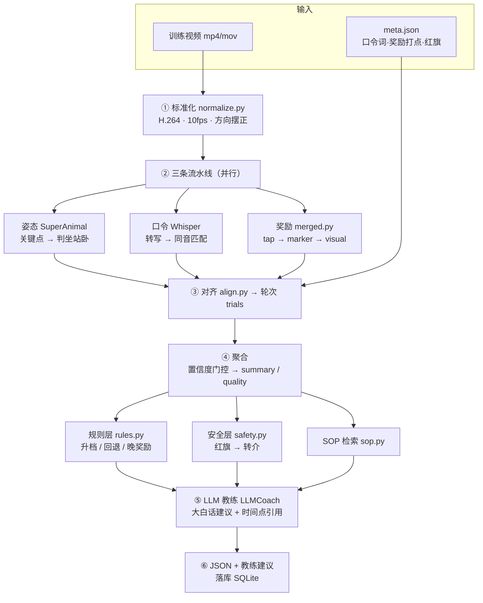
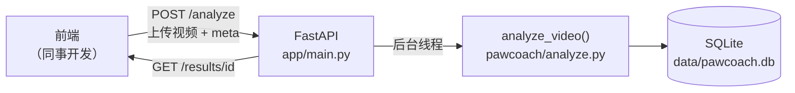

# PawCoach（AI 宠物训练教练）

基于手机训练视频的宠物行为训练 Agent —— 测量「口令 → 动作 → 奖励」的时间关系，积累训练记录，并生成下一次练习建议。

> 当前阶段：**Hackathon MVP**。只做「坐下 + 等待保持（Sit-Stay）」一个场景，只用公开 / 可授权数据。

## 一句话

把「视频 → JSON → 教练建议」这条链路跑通：先测量可回溯的数字（保持时长、反应延迟、奖励延迟……），再由规则 + 大模型「读数字」生成建议——**不让大模型直接看视频下结论**（依据 K9-Bench 实测，见 [datasets-and-papers.md §1](docs/datasets-and-papers.md)）。

## 架构图

### 数据流（视频 → 建议）



### API 部署（后端与前端的对接）



> 分析在后台线程跑（不上消息队列），前端拿到 `job_id` 后轮询 `GET /results/<id>`。接口契约见 [app/README.md](app/README.md)。

## 文档

- **[MVP 开发计划（跑通优先 · 按工时）](docs/CodePlan_detail.md)** ← 执行入口
- [开发进度](docs/PROGRESS.md)（当前：阶段 A～D 全部完成）
- [CodePlan（风险优先版）](docs/CodePlan.md)
- [数据集与论文调研](docs/datasets-and-papers.md)（最全，含许可红线与实测核对）
- [技术资源精选](docs/pet-training-agent-technical-resources.md)
- [早期调研](docs/research.md)

## 部署使用指南

### 1. 前置要求

- **Python 3.12 和 3.13**（两个版本都要：真姿态依赖的 deeplabcut 只支持到 3.12，轻装环境用 3.13）
- **ffmpeg**（视频标准化 / 抽帧，`brew install ffmpeg`）
- macOS / Linux（Windows 未验证）

### 2. 两个 Python 环境（关键，别混）

```bash
# 用 uv 管理两个 Python 版本（deeplabcut 3.x 需要精确 3.12）
uv python install 3.12 3.13

# 轻装环境 .venv（Python 3.13）：跑单测 + API 后端；analyze 里缺 pandas 会回退 stub 姿态
uv venv --python 3.13 .venv
uv pip install --python .venv/bin/python -r requirements.txt

# 重装环境 .venv-b（Python 3.12）：真姿态 + 真口令（deeplabcut 3.x 只支持到 3.12）
uv venv --python 3.12 .venv-b
uv pip install --python .venv-b/bin/python -r requirements-b.txt

# YOLO 狗检测权重（真姿态需要，放到 data/models/）
mkdir -p data/models
curl -L -o data/models/yolov8n.pt \
  https://github.com/ultralytics/assets/releases/download/v8.3.0/yolov8n.pt
```

> **要真姿态必须用 `.venv-b/bin/python`**，`.venv` 永远回退 stub（无真关键点）。Whisper 首次运行会自动下载 base 模型（约 139MB）到 `~/.cache/whisper`。

### 3. 配置 LLM

```bash
cp .env.example .env
# 编辑 .env 填 LLM_API_KEY（.env 已被 .gitignore 忽略，不会提交）
```

三个配置项（优先级：环境变量 > `.env` > 默认）：

| 项 | 说明 |
|---|---|
| `LLM_MODEL` | 模型名，默认 `deepseek-v4-flash`（赞助商 `/v1/models` 里的名字） |
| `LLM_API_KEY` | API key（黑客松额度赞助商提供） |
| `LLM_BASE_URL` | OpenAI 兼容地址，默认 `https://api.openai-next.com/v1/chat/completions` |

> 不配 key 也能跑——`LLMCoach` 会静默兜底 `TemplateCoach`（模板建议），但没有真大模型建议。配了才有。

### 4. 命令行使用

```bash
# 查看视频信息
python -m pawcoach.cli probe data/raw/<video_id>.mp4

# 分析一段训练视频（真姿态用 .venv-b；第一次跑会自动推理，约 80s/60s 视频）
.venv-b/bin/python -m pawcoach.cli analyze data/raw/<video_id>.mp4 -o results/<video_id>.json

# 30 用例评估（规则层 + 安全层确定性输出，.venv 即可）
.venv/bin/python -m pawcoach.cli eval cases eval/coach_cases.yaml

# 单测
PYTHONPATH=. .venv/bin/python -m pytest -q
```

输入：`data/raw/<video_id>.mp4` + 可选 `data/raw/<video_id>.meta.json`（口令词、手动打点的奖励时刻、`red_flags` 红旗）。
输出：`results/<video_id>.json`（结构化指标）+ 一段可读的教练建议。

### 5. 部署 API 后端

```bash
# 在项目根目录起服务（相对路径依赖 CWD）
.venv/bin/python -m uvicorn app.main:app --host 0.0.0.0 --port 8001
# 要真姿态就把解释器换成 .venv-b/bin/python；8000 端口可能被 Docker（Attu/Milvus）占用，默认用 8001
```

```bash
# 上传视频 + meta，拿 job_id
curl -F "file=@data/raw/sample.mp4" -F "meta=<data/raw/sample.meta.json" \
  http://127.0.0.1:8001/analyze
# 返回 {"job_id":"...","status":"pending"}

# 轮询结果（分析在后台线程跑，几秒到几十秒）
curl http://127.0.0.1:8001/results/<job_id>
# 返回 {"status":"done","result":{...}} 或 {"status":"pending"} / {"status":"failed","error":"..."}
```

接口契约与字段说明见 [app/README.md](app/README.md)。

### 6. 姿态推理与缓存

- 第一次分析某视频会**自动跑 SuperAnimal 推理**（降帧到 10fps，约 80s/60s 视频），结果缓存到 `data/pose/`（H5 关键点 + dogbox 检测框），下次直接读缓存。
- 缓存键 = 标准化产物名（30fps 视频会转成 `<id>.norm.mp4`，缓存按 `<id>.norm` 存）。
- 口令转写缓存按原始视频名存（`data/asr/<id>.json`），因为 whisper 转写的是音频、与帧率无关。

## 技术栈

Python 3.12 / 3.13 · ffmpeg · SuperAnimal (DeepLabCut) · Ultralytics YOLO · Whisper · FastAPI · SQLite · LLM API（OpenAI 兼容）

## 数据与许可

仅使用公开 / 可授权数据；来源与许可记录在 `data/sources.csv`，演示与文档满足 CC BY 署名要求。许可红线（哪些能商用、哪些仅研究用途）见 [datasets-and-papers.md §4.2](docs/datasets-and-papers.md)。

## 目录结构

见 [CodePlan_detail.md §6](docs/CodePlan_detail.md) 的完整规划。
